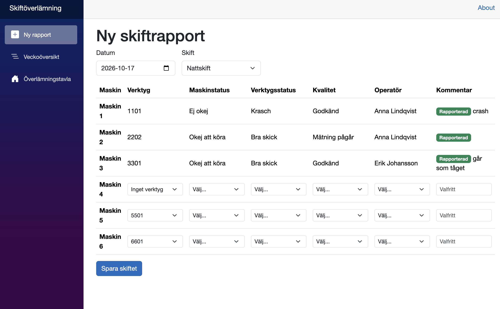
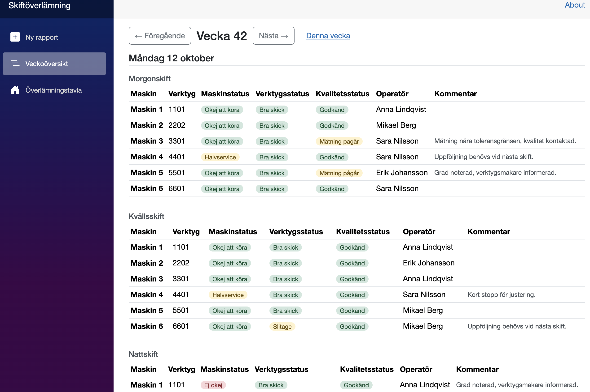
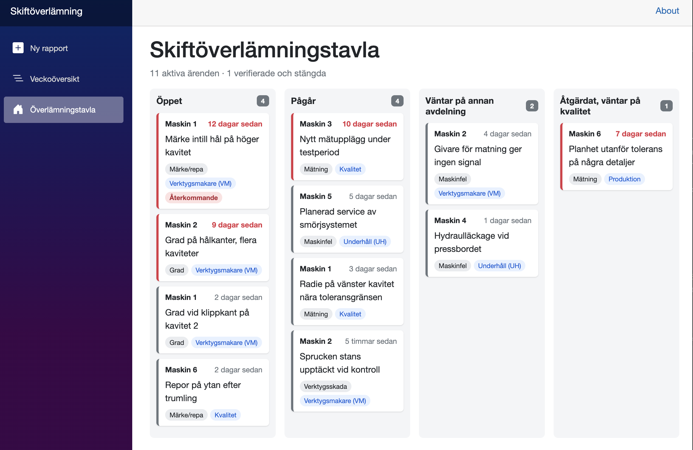

# ShiftHandover (Skiftöverlämning)

A digital shift handover tool for manufacturing, built with Blazor and .NET 9. Operators report the status of every machine at the end of each shift, and problems are automatically tracked until quality verifies them.

**Live demo:** https://shifthandover-yk-bhg0fveaf6fmdxex.swedencentral-01.azurewebsites.net
(The app runs on Azure's free tier and may take up to a minute to wake up.)

> All data in the demo is synthetic. No real production data, part numbers or names are used.

## Why I built it

I have worked as a machine operator in production since 2020. Shift handovers are often written as free text, so problems get reported, handed to another team ("ask the toolmaker to check"), and then forgotten. Statuses are inconsistent and nobody can see at a glance which issues are still open.

This app replaces free text with structured reports and turns every reported problem into a tracked issue.

## Features

| Page | What it does |
|---|---|
| **Ny rapport** | Report all six machines for a shift on one page: tool, machine status, tool status, quality and operator. Date and shift are preselected from the clock. |
| **Veckoöversikt** | Week view by day and shift, with colored statuses and "Ej rapporterad" for missing reports. |
| **Överlämningstavla** | Board of open issues: Öppet, Pågår, Väntar på annan avdelning, Åtgärdat. Old issues are highlighted, recurring problems are tagged. |





## Business rules

The rules live in the domain model, so they are enforced no matter where data comes from, and they are covered by unit tests.

- A tool crash means the machine cannot be "Okej att köra"
- "Ej okej" requires a reason: a tool problem or a comment
- An empty machine ("Tom") has no tool, tool status or quality
- Bad quality ("Ej okej", "Spärrad") requires a comment
- One report per machine, date and shift (also enforced by a unique index)
- A machine holds one tool at a time; tools move between machines and are tracked
- A tool crash, tool problem or bad quality automatically creates an issue for the right team, without duplicates
- Issues can only be verified after being fixed, and every status change is stored in a history

## Tech stack

- **Blazor Web App** (.NET 9, interactive server rendering)
- **Entity Framework Core** with **Azure SQL** (SQL Server in Docker locally)
- **xUnit** tests for domain rules and date logic
- **GitHub Actions** CI/CD: tests run before every deployment
- **Azure App Service** (Linux) and **Azure SQL** (serverless)

## Design decisions

- **Domain-driven rules:** business rules are in domain classes (`ShiftReport.Create`, `Issue.ChangeStatus`), not in the UI. During development, the rules even stopped invalid seed data from reaching the database.
- **DbContext factory:** Blazor Server keeps a connection open for a long time, so each operation gets its own short-lived DbContext, as recommended by Microsoft.
- **All-or-nothing saving:** a shift report saves all filled rows in one transaction, so a shift is never half-reported.
- **Swedish UI, English code:** the interface is in Swedish for the shop floor, the code is in English for international teams.
- **Time zone:** Azure runs on UTC, so the app sets `TZ=Europe/Stockholm`. Without it, a 07:00 report would be assigned to the night shift.

## Run locally

Requires the .NET 9 SDK and Docker.

```bash
docker run -e "ACCEPT_EULA=Y" -e "MSSQL_SA_PASSWORD=DevPassw0rd_2026" \
  -p 1433:1433 --name shifthandover-sql -d mcr.microsoft.com/mssql/server:2022-latest

cd src/ShiftHandover.Web
dotnet user-secrets set "ConnectionStrings:DefaultConnection" \
  "Server=localhost,1433;Database=ShiftHandover;User Id=sa;Password=DevPassw0rd_2026;TrustServerCertificate=True"
dotnet run
```

Migrations and demo data are applied automatically on startup.

Run the tests from the repository root:

```bash
dotnet test
```

## Possible next steps

- Login with roles (operator, team leader, quality, toolmaker)
- Issue details page for moving issues through the status flow
- Statistics: which tools and machines cause the most problems
- Upgrade to .NET 10 (LTS)
